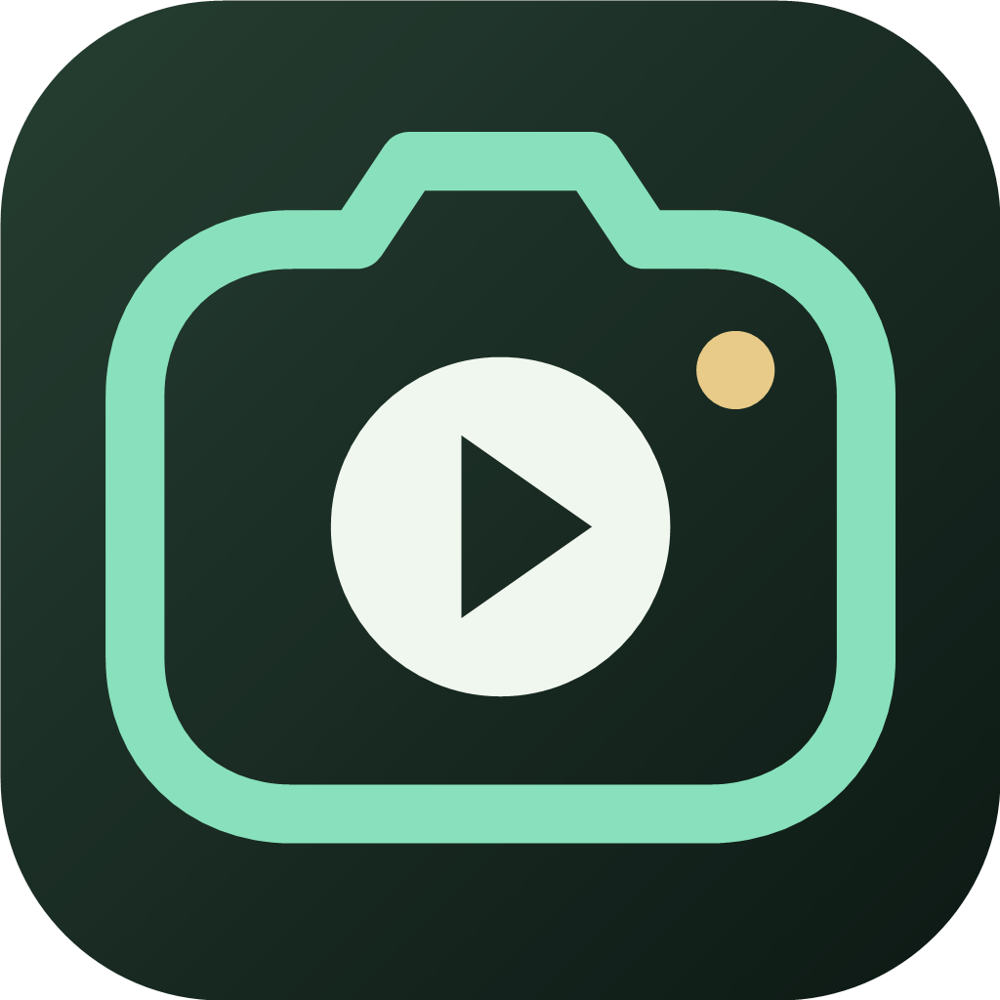

# 3P Capture Automator

Android touch recording and playback for authorised app testing.

## Latest APK and documents

**[Download 0.6.4-dev and supporting files](https://github.com/Mehul-Mridul/Android-Testing/releases/tag/v0.6.4-dev)** · **[Keyboard repair and physical test report](docs/releases/0.6.4/Keyboard-repair-status.md)** · **[Logo sources](branding/)**

Version **0.6.4-dev (version code 12)** keeps the touch controls visible when a keyboard opens, preserves the coordinate frame, excludes keyboard/password input and guards replay against keyboard/window changes. Capture layers also exclude the movable controls so Back/Stop taps reach them reliably. It retains the batch repairs from 0.6.3 and the existing logo.

**72 automated tests**, lint and debug/release builds passed. Physical checks on iQOO 9T / Android 14 passed the isolated keyboard recording/replay sequence and Instagram's local Story keyboard → Back → further touches → Discard. The normal signed APK was separately tested without instrumentation and is installed on the phone. Six original saved presets were preserved.

Typing is not recorded or replayed. Samsung phones/tablets were not physically tested here. Instagram replay/media verification and the full batch device matrix were not rerun in this keyboard-focused release. See the versioned report for exact evidence and limits; [0.6.3 batch evidence](docs/releases/0.6.3/Batch-repair-status.md) remains available.



## Install and record

1. Download `3P-Capture-Automator-0.6.4-dev.apk` from Releases. Use the debug APK only for diagnostics.
2. Update the matching-signature app without uninstalling or clearing storage. If Android reports a signature mismatch, stop and export presets before considering a different installation. The APK uses a local development signing key; certificate details and checksums are supplied with the release.
3. Enable Automator Accessibility through Android Settings, and grant the photo/video access needed for verification. After an update, reconnect Accessibility if Android leaves it disconnected. No protection bypass is provided.
4. Choose **Record new automation** and record one app at a time. Touch paths and timing are saved; app opening, Back and Recents use Accessibility assistance. Keyboard typing and password entry remain native and are not recorded/replayed; app touches and Back can continue around them.
5. Include the complete local save and return sequence. Wait for a save popup to finish before tapping the underlying editor. Record the actual Discard button when a confirmation appears. Stop, review, and save the preset.
6. Set the expected photo/video counts to the media actually saved. Playback success requires newly saved readable media when media verification is requested; a completed gesture alone does not prove a capture.
7. Before replay, match the recorded starting screen, orientation, app layout and window configuration. Coordinate recordings require calibration/new recording when those change.
8. For multiple apps, select separate presets in **Batch execution**. Batch manages its own cleanup before and after the sequence; each preset’s standalone cleanup checkbox does not trigger cleanup between batch items. Stop cancels pending actions. Android may retain locked/protected tasks.

Original presets are not silently repaired or overwritten. Old Instagram presets missing Discard or containing a transient-popup tap need a newly recorded copy. Test presets retained on the inspected device are identified in the repair report.

## Build and checks

Use JDK 17, Android SDK Platform/Build Tools 35, and Gradle 8.10.2. Open this repository in Android Studio, or run:

```sh
gradle :core:test :app:testDebugUnitTest :app:lintDebug :app:assembleDebug :app:assembleRelease
```

The debug APK is written to `app/build/outputs/apk/debug/`. The normal release build is unsigned until signed with your preserved key. Never commit a keystore, signing password, local SDK configuration or account credentials.

## Source and documentation

- `core/`: preset schemas, playback policy, validation and JVM tests.
- `app/`: Compose UI, explicit touch recorder, Accessibility-assisted playback, MediaStore verification, Room storage and batch execution.
- `docs/releases/`: versioned repair findings, installation, automated and physical evidence, build logs, signatures and checksums.
- Release assets: normal/debug APKs, exact app-source archive, patch and full document bundle.
- Other files under `docs/` include earlier design/feasibility material; versioned release evidence describes the current validation scope.

The app is for explicit authorised testing. It does not bypass Android permissions, collect hidden typed text, publish Stories, or send media/messages. MediaStore cannot verify files kept only in another app’s private storage. Coordinate playback cannot guarantee portability across devices or changing app interfaces.
